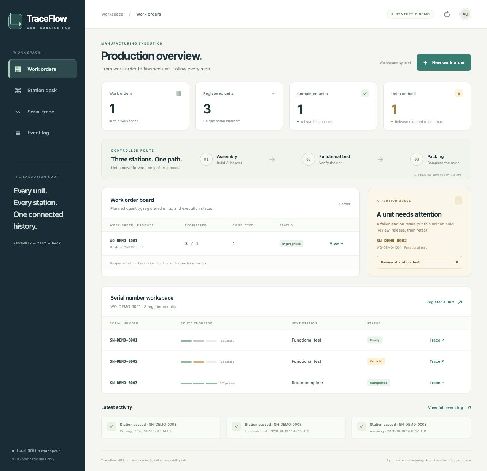
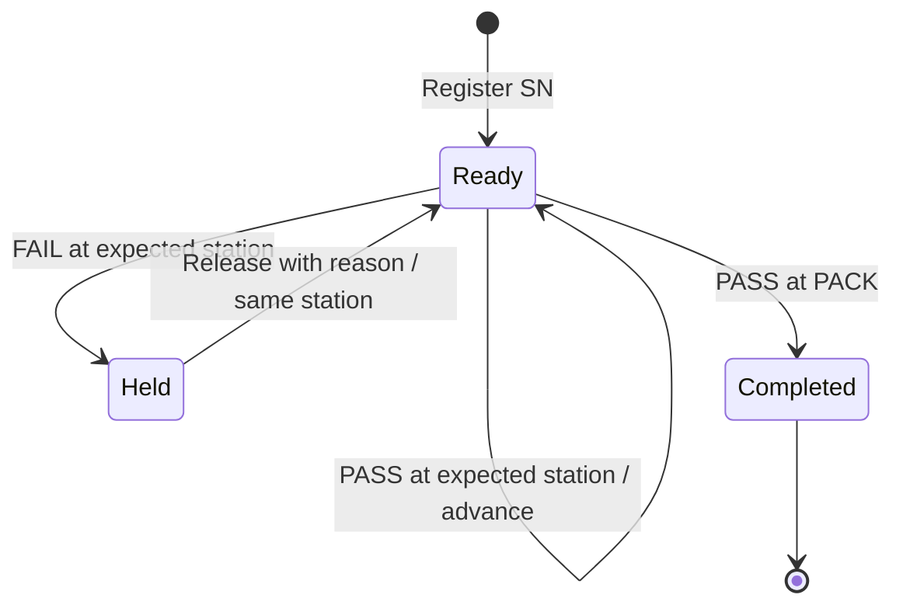

# TraceFlow MES — Historical predecessor

> [!IMPORTANT]
> This project has been consolidated into [TraceGate Manufacturing Traceability](https://github.com/weiyu1029/tracegate-edge) as the maintained [.NET MES Lab](https://github.com/weiyu1029/tracegate-edge/tree/main/labs/dotnet-mes). The canonical repository now contains the current code, renamed interface, screenshots, documentation, and combined CI. This repository remains available as the historical predecessor.

A small manufacturing execution learning lab: **work order → serial number → station execution → trace history**.

Built with C#, ASP.NET Core Minimal API, parameterized SQLite SQL, and a dependency-free browser UI. All sample products, operators, orders, and serial numbers are synthetic.



## Why this project

After a C# material inquiry application, the next useful step is to implement manufacturing workflow rules and persistent writes. TraceFlow focuses on one concrete question: **can this serial number proceed to this station, and can we explain its history?**

- Create a work order and register serial numbers within its planned quantity.
- Enforce a fixed route: `ASSEMBLY → TEST → PACK`.
- Put a failed unit on hold; require a release reason and a retest at the same station.
- Keep an append-only event history with operator text and UTC timestamps.
- Handle repeated HTTP requests with persistent idempotency keys.
- Export event data to CSV with spreadsheet formula prefixes escaped.

This is a local learning prototype developed with AI assistance. It is not a production MES or an ISA-95 conformance claim. It has no authentication, authorization, PLC/ERP integration, configurable routing, rework routing, or production deployment setup. The operator field is a label, not a verified identity. Keep it on localhost and use synthetic data.

## Run locally

Install the [.NET 10 SDK](https://dotnet.microsoft.com/download/dotnet/10.0). A newer .NET 10 feature band works through `global.json`. SQLite is supplied by the NuGet package; a separate database server is unnecessary.

```sh
dotnet restore src/TraceFlow.Web
dotnet run --project src/TraceFlow.Web
```

Open **http://localhost:5080**. On Windows, the same commands run in PowerShell. The first run creates `src/TraceFlow.Web/App_Data/traceflow.db` and synthetic demo records. Restarting preserves that database.

| Seed serial | Initial state | Next station |
| --- | --- | --- |
| SN-DEMO-0001 | Ready; assembly passed | TEST |
| SN-DEMO-0002 | Held; test failed | TEST |
| SN-DEMO-0003 | Completed | None |

To get a fresh demo without changing an existing database, stop the server and choose a new database path:

```sh
# macOS / Linux
MES_DB_PATH=/tmp/traceflow-new-demo.db dotnet run --project src/TraceFlow.Web
```

```powershell
# Windows PowerShell
$env:MES_DB_PATH = Join-Path $env:TEMP ('traceflow-' + [guid]::NewGuid() + '.db')
dotnet run --project src/TraceFlow.Web
```

Configuration: `MES_DB_PATH` changes the file location; `MES_SEED_DEMO=false` starts an empty database. `ASPNETCORE_URLS` overrides the default loopback URL. Avoid binding this unauthenticated demo to a public interface.

## Verify the rules

Python 3 is needed only for the tests; there are no Python package dependencies.

```sh
dotnet build src/TraceFlow.Web
python3 -m unittest discover -s tests -v
```

On Windows, use `python` or `py -3` in place of `python3` if needed. Tests start the built server on a temporary local port, use a temporary SQLite file, and stop the process when done. They cover route order, failure/release/retest, completed-unit rejection, global serial uniqueness, capacity, validation, retry behavior, concurrent writes, append-only triggers, CSV safety, and persistence after restart. The GitHub Actions workflow runs the same build and suite.

See [validation evidence](docs/VALIDATION.md) for the actual local result and limits of the checks. A configured CI workflow is not itself evidence that a hosted run passed.

## How the state changes



A release never means a test passed. A rejected request never adds a station event. Updating the unit and appending its event occur in the same database transaction. Serial number uniqueness and work-order capacity are checked inside that write transaction.

An accepted mutation stores its request ID, normalized payload hash, HTTP status, and response in that transaction. Repeating the same request returns the original response; reusing its ID with a different payload returns HTTP 409. A client must retry an uncertain request with its original ID. Rejected requests are not cached. Idempotency records have no expiry in this small demo.

Event UPDATE and DELETE are blocked by SQLite triggers. This supports application-level history integrity; someone with full database-file access can still alter the file or remove the triggers. It is not tamper-proof storage.

## API

All writes require `operator` and a new UUID `requestId`. IDs and station codes are normalized to uppercase. Read [the code](src/TraceFlow.Web/MesStore.cs) for the exact limits and rules.

| Method | Path | Purpose |
| --- | --- | --- |
| GET | `/api/health` | Check service and database |
| GET | `/api/meta` | Fixed route and demo metadata |
| GET | `/api/dashboard` | Counts from stored records |
| GET / POST | `/api/work-orders` | List / create orders |
| GET | `/api/work-orders/{no}/units` | Units belonging to an order |
| POST | `/api/units/register` | Register a unique SN |
| POST | `/api/units/{sn}/station-events` | Report PASS or FAIL |
| POST | `/api/units/{sn}/release-hold` | Release with a reason |
| GET | `/api/units/{sn}/trace` | Unit, order, route, event history |
| GET | `/api/events` | Recent events, optional `workOrderNo` and `limit` |
| GET | `/api/events/export.csv` | Event CSV, optional `workOrderNo` |

Errors use HTTP 400 for invalid input, 404 for missing resources, and 409 for workflow conflicts. A busy database returns 503. Retry uncertain writes using the same request ID.

## Read the project

```text
src/TraceFlow.Web/
  Program.cs          HTTP endpoints and error boundary
  Models.cs           Request and response records
  MesStore.cs         SQL, transactions, domain rules, seed data
  wwwroot/            Accessible HTML, CSS, browser interactions
tests/test_api.py     Black-box process + SQLite integration tests
docs/                Learning path, demo script, verification evidence
```

The small store intentionally keeps SQL visible for a C# learner. A future exercise could split its validation and persistence responsibilities, add authenticated roles, model process versions, or compare SQL Server transaction behavior. Those extensions are outside this version.

## Learn and share

- [Traditional Chinese learning path](docs/LEARNING_PATH.zh-TW.md): official online courses, costs, achievements, and project mapping.
- [Traditional Chinese 60–90 second demo guide](docs/DEMO_GUIDE.zh-TW.md): skip-station rejection, hold release, retest, completion, and trace.
- [Microsoft.Data.Sqlite transactions](https://learn.microsoft.com/dotnet/standard/data/sqlite/transactions): implementation reference.

Course links are recommendations, not claims that the author completed a course or received a certificate. MIT license; synthetic demo assets only.
